# Cosmetics Shop

## 1. Лаб. 01. Бази даних трьох мікросервісів

### 1.1. Опис предметної області
Cosmetics Shop — інтернет-магазин доглядової косметики. Покупець шукає засіб під свій тип шкіри (суха, жирна, комбінована, чутлива), дивиться склад і спосіб застосування, купує з промокодом, а після використання пише відгук. Менеджер магазину веде каталог брендів і категорій та проводить замовлення через усі статуси аж до відправлення.

Система поділена на три контексти, у кожного своя база: замовлення (CosmeticsOrdersDb), каталог (CosmeticsCatalogDb) і відгуки (cosmetics_reviews). Які сутності належать кожному контексту — у docs/architecture.md, агрегати — у docs/aggregates.md.

### 1.2. Технологія зберігання для кожного контексту
Проєкт №1 — замовлення, CosmeticsOrdersDb: SQL Server, доступ через ADO.NET і Dapper.
У замовлення є чіткий ланцюжок статусів, і кожен крок має виконатися повністю або не виконатися зовсім. Тому логіка винесена в збережувані процедури: usp_ChangeOrderStatus у транзакції перевіряє, чи дозволений перехід, а під час підтвердження наявності одразу списує товар зі складу. Поле RowVersion не дає двом менеджерам непомітно перезаписати зміни одне одного.

Проєкт №2 — каталог, CosmeticsCatalogDb: SQL Server, EF Core (Code First).
Каталог складається з довідників і таблиць, прив'язаних до товару, а бізнес-логіки в ньому мало. Тут є всі три види зв'язків: бренд і його товари (1:N), товар і його склад, об'єм, тип шкіри (1:1), товари й категорії через ProductCategories з датою додавання (M:N). У Лаб. 03 зв'язки буде описано у Fluent API, бренди й категорії задано через HasData, а кожну зміну таблиць оформлено міграцією.

Проєкт №3 — відгуки, cosmetics_reviews: MongoDB.
Відгуки на косметику дуже різні: хтось додає фото чи відео, хтось пише, скільки тижнів користувався засобом, хтось лише ставить оцінку. Документи дозволяють зберігати це без порожніх колонок. Тип шкіри автора та відповіді на відгук потрібні щоразу, коли відгук показується, тому вони лежать усередині документа. Обговорення може розростися до сотень повідомлень, тому повідомлення зберігаються в окремій колекції, а в самому обговоренні лишаються тільки останні два-три. Назва товару скопійована у відгук, щоб сторінка відгуків не залежала від Каталогу.

### 1.3. Таблиця політики дублювання даних
| Поле | Де зберігається | Джерело (власник даних) | Політика узгодженості |
|---|---|---|---|
| OrderItems.ProductId | CosmeticsOrdersDb | Products у CosmeticsCatalogDb | звичайний стовпець з Id товару, FOREIGN KEY на іншу базу немає |
| OrderItems.ProductName, UnitPrice | CosmeticsOrdersDb | Products у CosmeticsCatalogDb | знімок: записується, коли товар додають у замовлення, і далі не змінюється |
| Products.Name, Price (локальний довідник) | CosmeticsOrdersDb | Products у CosmeticsCatalogDb | оновлюється, коли Каталог надсилає подію про зміну товару |
| reviews.productId, discussions.productId | cosmetics_reviews | Products у CosmeticsCatalogDb | число з Id товару, без зовнішнього ключа |
| reviews.productName, discussions.productName | cosmetics_reviews | Products у CosmeticsCatalogDb | оновлюється за подією про зміну товару з Каталогу |
| reviews.author.customerId | cosmetics_reviews | Customers у CosmeticsOrdersDb | Id покупця, без зовнішнього ключа |
| reviews.author.displayName, discussion_messages.author.displayName | cosmetics_reviews | Customers у CosmeticsOrdersDb | оновлюється за подією про зміну профілю покупця |

Змінювати ці поля має право лише база-власник, решта баз їх тільки читає. Товари мають однакові Id 1–8 в усіх трьох базах.

### 1.4. Як розгорнути бази
SQL-скрипти виконуються в SSMS: File → Open → File, потім Execute. Усі скрипти можна запускати повторно: таблиці не перестворюються, а seed перед вставкою перевіряє, чи запис уже є.

1.4.1. CosmeticsOrdersDb (Проєкт №1), строго в такому порядку:
1. db/p1/schema.sql — створює базу, таблиці, ключі, CHECK, DEFAULT, індекси, аудитні колонки, RowVersion і представлення vw_OrderSummary.
2. db/p1/procedures.sql — процедури usp_CreateOrder, usp_AddOrderItem, usp_GetOrderById, usp_UpdateOrderDetails, usp_ChangeOrderStatus, usp_SoftDeleteOrder.
3. db/p1/seed.sql — покупці, промокоди, товари й три замовлення (seed використовує процедури, тому йде останнім).
4. db/p1/002_confirm_order.sql — процедура usp_ConfirmOrder, додана в Лаб. 02 для підтвердження замовлення.

1.4.2. CosmeticsCatalogDb (Проєкт №2):
1. db/p2/schema.sql — база, таблиці, обмеження, індекси, представлення vw_ProductCatalog.
2. db/p2/seed.sql — бренди, категорії, товари зі складом і типом шкіри, прив'язки до категорій, зображення.

1.4.3. cosmetics_reviews (Проєкт №3), у PowerShell з кореня репозиторію:
```
mongosh db/p3/collections.js
mongosh db/p3/seed.js
```
Перший скрипт створює колекції з валідацією та індекси, другий наповнює їх. Приклади запитів і агрегацій — db/p3/queries.js.

Запити для перевірки баз — docs/checks.md, зміни схем — docs/migrations.md.

### 1.5. ERD-діаграми
Проєкт №1, CosmeticsOrdersDb:

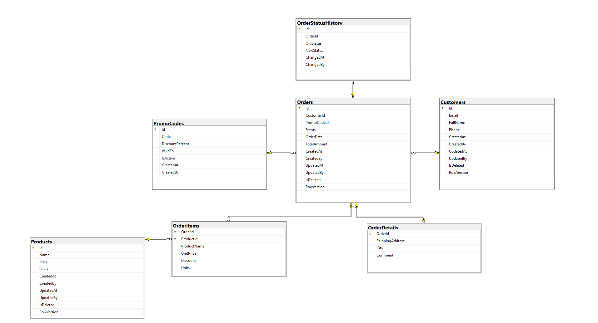

Проєкт №2, CosmeticsCatalogDb:

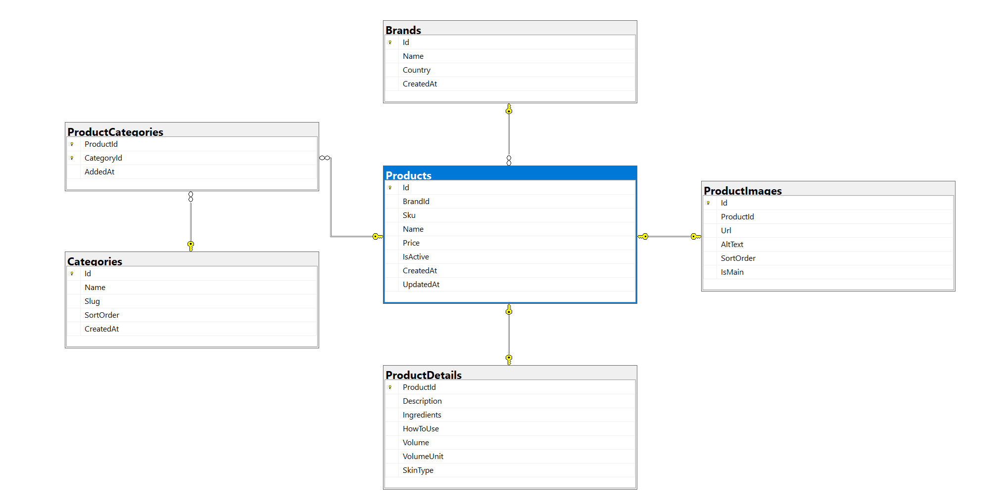

## 2. Лаб. 02. Сервіс замовлень: тришарова архітектура на ADO.NET і Dapper

### 2.1. Схема рішення
```
Platform.slnx
├── Platform.AppHost/       Aspire: запускає orders-api і передає рядок підключення OrdersDb
└── Services/Orders/
    ├── Orders.Api/         контролери, Program.cs, обробка помилок (ProblemDetails), Swagger
    ├── Orders.Bll/         сервіси, DTO, профіль AutoMapper
    ├── Orders.Dal/         репозиторії (ADO.NET і Dapper), Unit of Work
    └── Orders.Domain/      моделі, доменні винятки
```
Залежності йдуть в один бік: Api → Bll → Dal → Domain.

### 2.2. Що потрібно для запуску
- .NET 10 SDK;
- SQL Server з базою CosmeticsOrdersDb, розгорнутою за розділом 1.4.1 (разом із 002_confirm_order.sql).

### 2.3. Запуск через Aspire
1. У Platform.AppHost/appsettings.json вказати свій сервер у ConnectionStrings:OrdersDb.
2. З кореня репозиторію:
   ```
   dotnet run --project Platform.AppHost
   ```
3. Відкрити посилання на Dashboard з консолі: orders-api і OrdersDb мають статус Running.
4. Відкрити адресу orders-api з Dashboard і дописати /swagger.

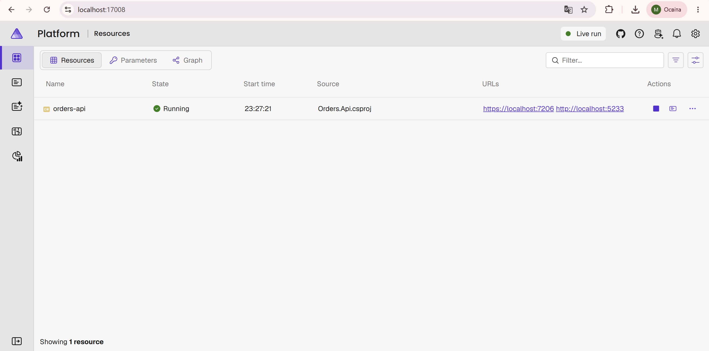

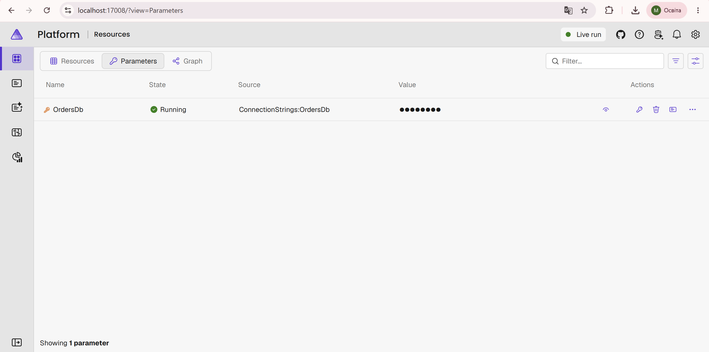

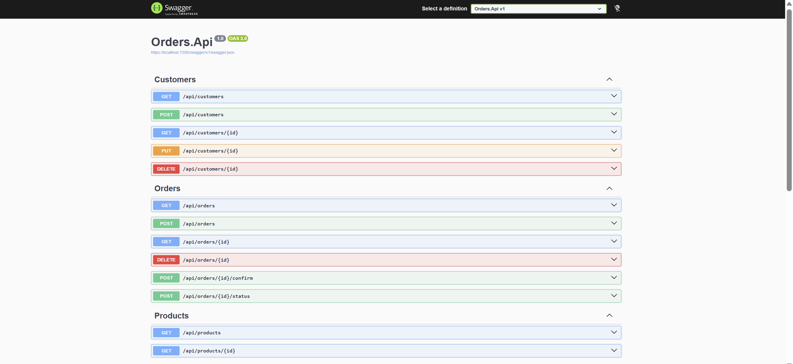

### 2.4. Транзакції та рівень ізоляції
Unit of Work відкриває одне з'єднання на запит і одну транзакцію для всіх репозиторіїв. Рівень ізоляції ReadCommitted: вищі рівні (RepeatableRead, Serializable) дають менше аномалій читання, але більше блокувань і ризик deadlock. Таймаут команд 30 с. Створення й підтвердження замовлення виконуються в одній транзакції: якщо товару бракує, усі зміни відкочуються.

### 2.5. Приклади запитів
Порт беремо з Aspire Dashboard.
```bash
curl -k https://localhost:7206/api/products

curl -k https://localhost:7206/api/orders/2

curl -k -X POST https://localhost:7206/api/customers \
  -H "Content-Type: application/json" \
  -d '{"email":"obrien2@example.com","fullName":"Sinéad O'\''Brien","phone":"+353871234567"}'

curl -k -X POST https://localhost:7206/api/orders \
  -H "Content-Type: application/json" \
  -d '{"customerId":1,"shippingAddress":"вул. Головна, 10","city":"Чернівці","promoCode":"WELCOME10","items":[{"productId":3,"units":2},{"productId":5,"units":1}]}'

curl -k -X POST https://localhost:7206/api/orders/4/confirm

curl -k -X POST https://localhost:7206/api/orders/1/status \
  -H "Content-Type: application/json" \
  -d '{"status":"AwaitingValidation"}'

curl -k -X DELETE https://localhost:7206/api/orders/3
```
Помилки повертаються у форматі ProblemDetails: 400 (валідація), 404 (не знайдено), 409 (бізнес-конфлікт).


## 3. Лаб. 03. Сервіс каталогу: тришарова архітектура на EF Core

### 3.1. Схема рішення
```
Services/Catalog/
├── Catalog.Api/       контролери, Program.cs, обробка помилок (ProblemDetails), Serilog, Swagger, Dockerfile
├── Catalog.Bll/       сервіси, DTO, AutoMapper, валідатори FluentValidation, специфікації
├── Catalog.Dal/       CatalogDbContext, Configurations/, Migrations/, репозиторії, Unit of Work, Seeding/
└── Catalog.Domain/    сутності з бізнес-правилами, доменні винятки
```
Залежності йдуть в один бік: Api → Bll → Dal → Domain.

### 3.2. Що потрібно для запуску
- .NET 10 SDK і інструмент dotnet-ef (`dotnet tool install --global dotnet-ef`);
- SQL Server. Рядок підключення: Services/Catalog/Catalog.Api/appsettings.json, ключ ConnectionStrings:CatalogDb.

Схема створюється міграціями в окрему базу CosmeticsCatalogEfDb, тому скрипти db/p2 з Лаб. 01 не потрібні.

### 3.3. Міграції
З кореня репозиторію:
```
dotnet ef migrations add <Назва> --project Services/Catalog/Catalog.Dal --startup-project Services/Catalog/Catalog.Api --output-dir Migrations
dotnet ef database update --project Services/Catalog/Catalog.Dal --startup-project Services/Catalog/Catalog.Api
dotnet ef migrations script --project Services/Catalog/Catalog.Dal --startup-project Services/Catalog/Catalog.Api --idempotent --output Services/Catalog/Catalog.Dal/Migrations/InitialCreate.sql
```
Початкова міграція InitialCreate і згенерований SQL-скрипт лежать у Services/Catalog/Catalog.Dal/Migrations.

### 3.4. Запуск
```
dotnet run --project Services/Catalog/Catalog.Api
```
Під час старту застосунок сам застосовує міграції (MigrateAsync) і наповнює базу:
- бренди й категорії вставляє міграція через HasData з фіксованими Id;
- товари додає DbInitializer лише для тих SKU, яких ще немає, тому повторний запуск не створює дублікатів;
- сідінг не виконується в Production або при `Seeding:Enabled = false`.

Swagger: адреса з консолі (`Now listening on ...`) + /swagger.

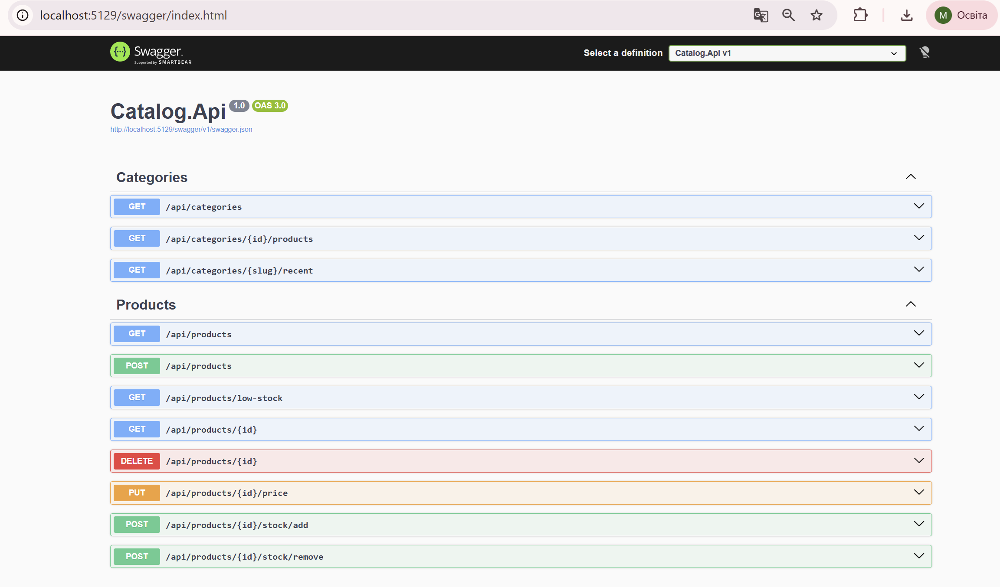

### 3.5. Пагінація, фільтрація, сортування
GET /api/products приймає: page (від 1), pageSize (за замовчуванням 10, максимум 50), search, brandId, categoryId, skinType, minPrice, maxPrice, inStock, sortBy (name, price, stock, createdAt), sortDir (asc, desc). Фільтри, сортування і Skip/Take виконуються в SQL.

Метадані повертаються в тілі (items, totalCount, page, pageSize, totalPages, hasNext, hasPrevious) і в заголовках X-Total-Count, X-Total-Pages.

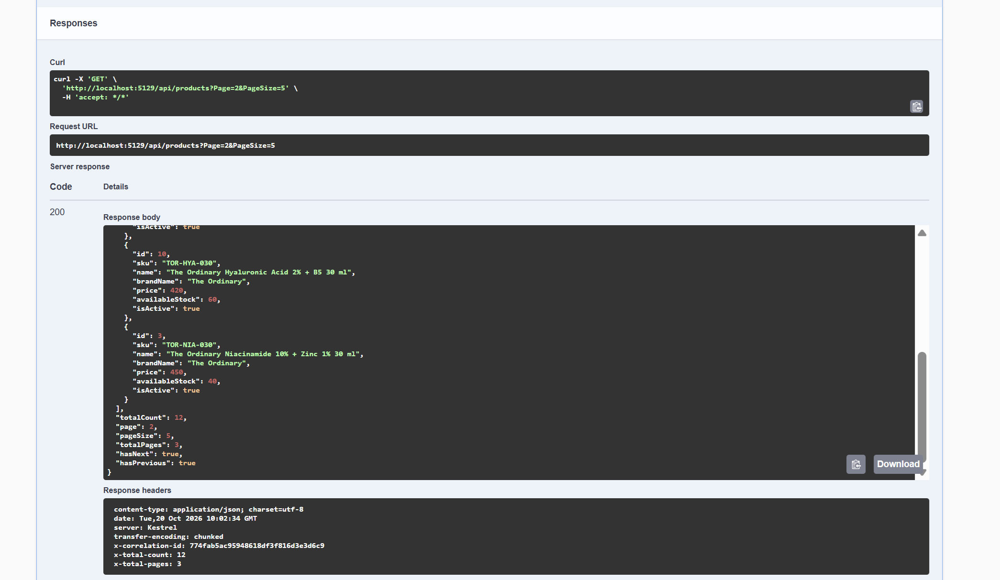

### 3.6. Валідація і помилки
Прості правила — DataAnnotations на DTO, складні — валідатори FluentValidation, які викликаються явно в контролерах. Помилки валідації повертаються як ValidationProblemDetails (400). Інші помилки обробляє GlobalExceptionHandler у форматі ProblemDetails: EntityNotFoundException → 404, ValidationException → 400, ConflictException і DomainException → 409.

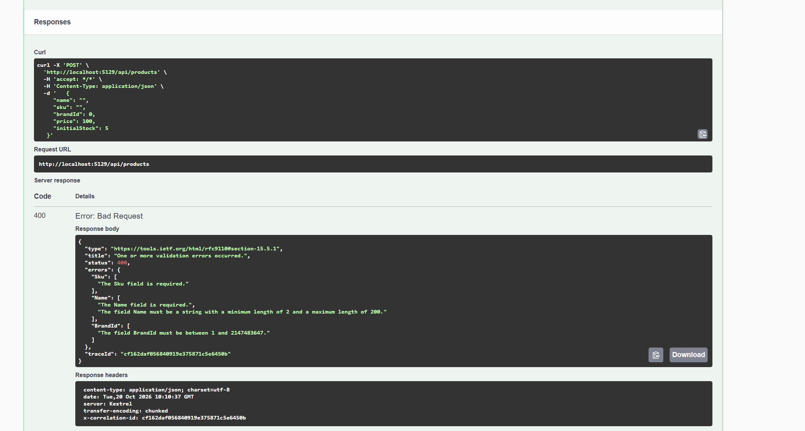

### 3.7. Логування
Serilog налаштовано в Program.cs і в секції Serilog файлу appsettings.json; рівні можна перевизначити змінними оточення (наприклад, `Serilog__MinimumLevel__Default=Warning`). Sink — консоль. Кожен запис містить CorrelationId (заголовок X-Correlation-Id), UserId і RequestPath. Рівень Information для Microsoft.EntityFrameworkCore.Database.Command показує SQL-запити: eager-завантаження товару виконує один запит, explicit-завантаження товарів категорії — два.

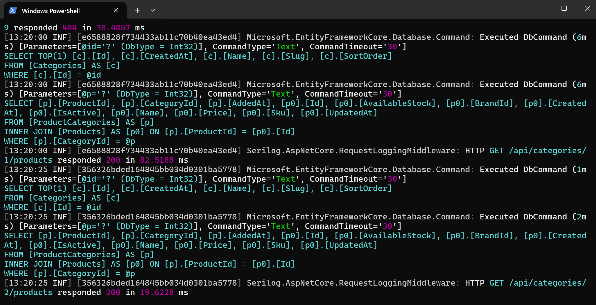


## 4. Лаб. 04. Сервіс відгуків: Clean Architecture, CQRS (MediatR) і MongoDB

### 4.1. Схема шарів
```
Services/Reviews/
├── Reviews.Domain/          сутності (Review, Discussion), value objects (Author, Rating, UsageDuration),
│                            інтерфейси репозиторіїв, доменні винятки; із зовнішніх пакетів лише MongoDB.Bson
├── Reviews.Application/     команди й запити MediatR, обробники, валідатори FluentValidation,
│                            Behaviors (Logging → Validation → Performance), IReviewQueries, AutoMapper
├── Reviews.Infrastructure/  MongoDbContext, BsonClassMap-мапінг, репозиторії, ReviewQueries,
│                            створення індексів, сідінг
└── Reviews.WebApi/          контролери (лише ISender), обробка помилок ProblemDetails, Program.cs, appsettings
```
Залежності спрямовані всередину: Application → Domain; Infrastructure → Application, Domain; WebApi → Application, Infrastructure (лише для реєстрації залежностей). Domain не посилається на жоден інший проєкт.

### 4.2. Що потрібно для запуску
- .NET 10 SDK;
- MongoDB на localhost:27017 з базою cosmetics_reviews, створеною скриптами db/p3 з Лаб. 01 (розділ 1.4.3). Якщо колекції порожні, сервіс сам наповнить їх під час старту.

### 4.3. Запуск
```
dotnet run --project Services/Reviews/Reviews.WebApi
```
Під час старту сервіс створює індекси (складений productId + createdAt, текстовий по title і text, унікальний «один відгук покупця на товар») і запускає сідінг лише для порожніх колекцій, тому повторний запуск не дублює дані. Swagger: адреса з консолі (`Now listening on ...`) + /swagger; стан підключення до MongoDB: /health.

Налаштування в секції MongoDb файлу Services/Reviews/Reviews.WebApi/appsettings.json (окремі значення в appsettings.Development.json, appsettings.Staging.json, appsettings.Production.json):
```json
"MongoDb": {
  "ConnectionString": "mongodb://localhost:27017/?maxPoolSize=50&serverSelectionTimeoutMS=5000",
  "DatabaseName": "cosmetics_reviews",
  "SeedData": true
}
```
У Production сідінг вимкнено (`SeedData: false`).

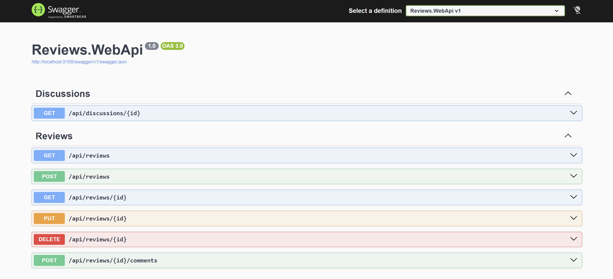

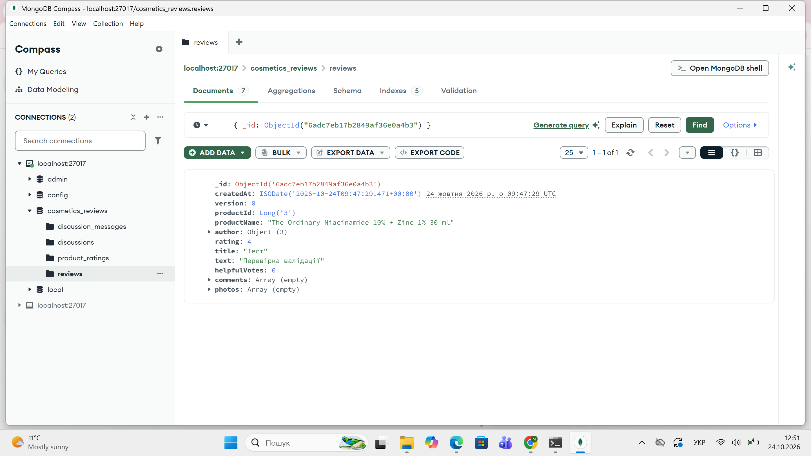

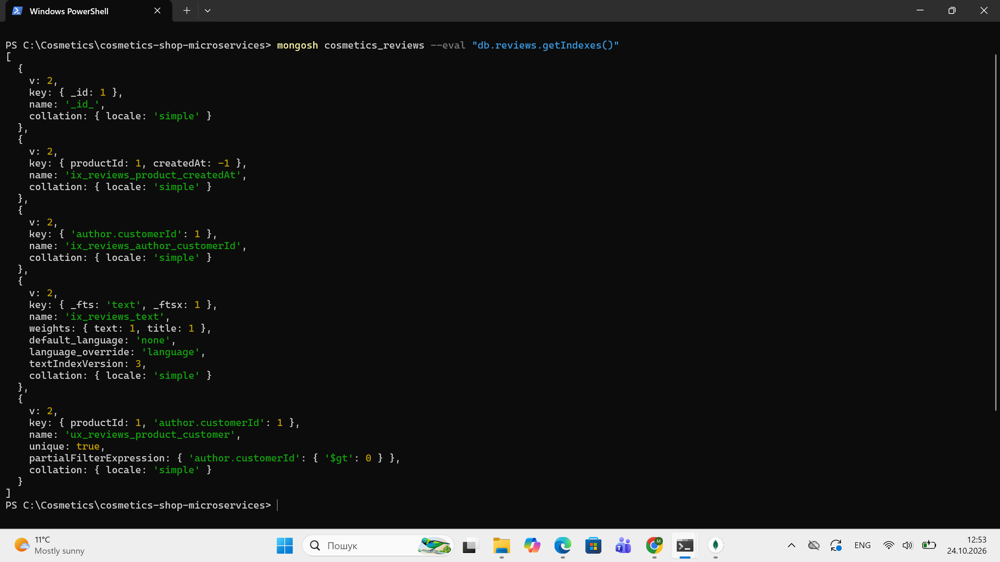
